# Pairo

A device that checks the feet of diabetic patients for temperature changes.

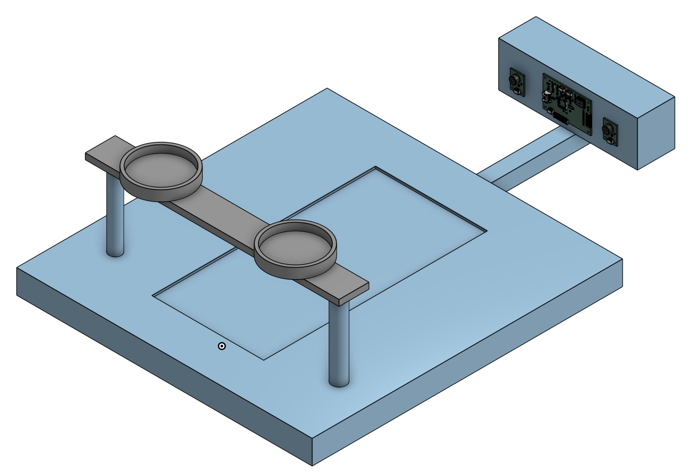

Diabetic foot ulcers often start as a warm spot days before anything can be seen. Pairo checks both soles with thermal sensors, compares left and right, and warns when one spot is more than 2.2 °C warmer than the same spot on the other foot. It also does a rewarming test: after a short touch on a cooled aluminium plate, it measures how fast each zone of the foot warms back up and shows it as a recovery map.

This is a research prototype for a student project, not a medical device, and I will only test it on healthy people.

## Why I made it

About one in three people with diabetes gets a foot ulcer at some point in their life, and many of them lead to amputations. Every 20 seconds someone in the world loses a leg because of diabetes, and around 85 % of these amputations started with a foot ulcer. So if you catch the ulcer early, you can stop a lot of amputations from happening. Doctors already know that a temperature difference between the feet is an early warning sign, but checking it every day at home is hard, especially for older people who can't bend down to look at their own feet. This is the problem Pairo is trying to solve: it should make checking your feet so quick and easy that it becomes a daily habit. You just put your heels in the cups, the scan starts by itself, and after a few seconds Pairo says the result out loud and shows green, yellow or red.

## How it works

1. The person sits and puts both heels into the heel cups and then two heel switches start the scan automatically.
2. The head (on the arm behind the plate) looks at both soles with:
   - two MLX90640 thermal sensors
   - an OV5640 colour camera, to find the outline of each foot
3. The ESP32-S3 on the main board takes the heat images of the feet, splits them into left and right foot, mirrors one, and compares the same spots on both feet.
4. Rewarming test: a Peltier element cools the aluminium plate to about 15 °C, with a fan and a heat sink on its hot side. A TMP117 sensor measures the plate temperature so the ESP32 can control it. The feet touch the plate for max. 30 s, then Pairo measures how fast each zone warms up again and makes a recovery map.
5. The results are spoken through the speaker and shown using green, yellow and red LEDs. Later, the results will also be sent to the carer's phone over WiFi.

## Hardware

Pairo has four PCBs, and I designed all of them myself in KiCad:

### Main board
The main board is 10 × 8 cm and has 2 layers. The brain of Pairo is an ESP32-S3. It reads all the sensors and compares both feet, and it has WiFi, so later the result can be sent to the carer's phone. Pairo gets its power through USB-C. A small chip called CH224A asks the charger for 9 V instead of the normal 5 V, because the Peltier needs a lot of power. Another chip, the MP2315, turns the 9 V into 3.3 V for the ESP32 and the sensors. For the sound there is an amplifier (MAX98357A) that drives the speaker, so Pairo can say the result out loud. The Peltier and the fan are switched on and off by two MOSFETs, which are like electronic switches, because the ESP32 can't give that much power by itself. Next to them are diodes that protect the MOSFETs from voltage spikes when the Peltier or fan turns off. The Peltier and fan wires go into screw terminals. The board also has plugs for the two heel switches, green, yellow and red LEDs for the result, RESET and BOOT buttons, and a 30-pin flat cable that goes up the arm to the head board.

### Head board
The head board is 6.4 × 4 cm and has 2 layers. It sits in the head at the end of the arm and looks down at the feet. The OV5640 camera plugs into it. The camera needs its own voltages (1.5 V and 2.8 V), so there are two small regulators that change the voltage. The camera also has to be switched on in the right order, so a helper chip (TCA9534) does that. There is also a small sensor (SHT40) that measures the room temperature and humidity, because a cold room makes the feet colder and the readings have to be corrected. The head board has three small plugs: two for the MLX90640 boards (one for each foot) and one for the TMP117 board. I also left a socket for a FLIR Lepton thermal camera on the board, so I can upgrade it later.

### MLX90640 boards
There are two of these (one for each foot) and they are 1.8 × 2.4 cm big. Each one holds an MLX90640 thermal sensor, which sees heat as a picture of 32 × 24 pixels. On the board there are also small capacitors that keep the power clean, and a plug for the cable to the head board.

### TMP117 board
This board is 1.4 × 1.2 cm big. It sits on the aluminium plate and has a TMP117 sensor on it, which measures the plate temperature. The ESP32 uses this to switch the Peltier on and off, so the plate stays at about 15 °C. It also has a capacitor and a plug for the cable.

The ground is done as copper areas on both layers with stitching vias.

The ESP32 switches the Peltier with pin 39 and the fan with pin 45. Pairo needs a USB-C charger that can give 9 V and 3 A, because the Peltier alone uses about 2 A.

## Pictures

### Main board
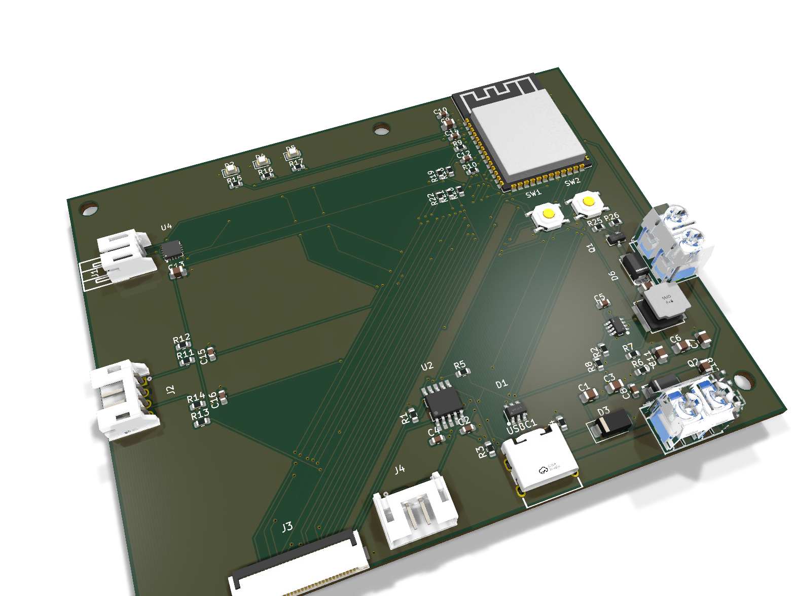
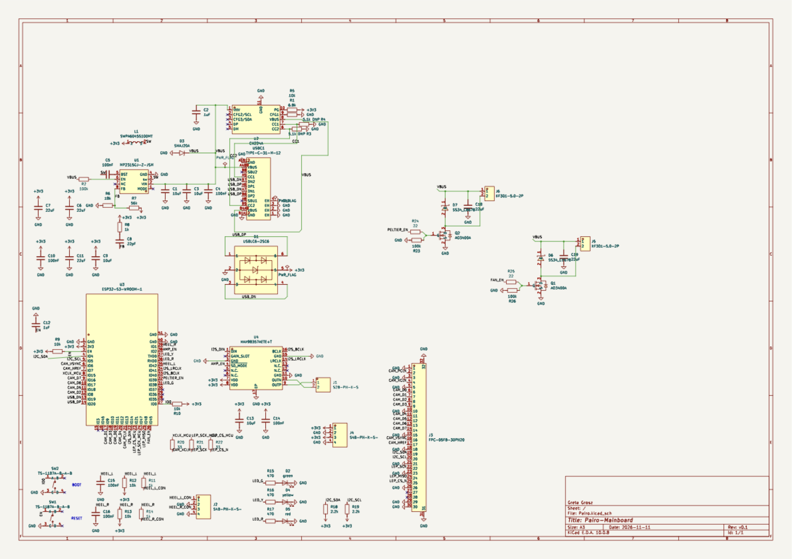

### Head board
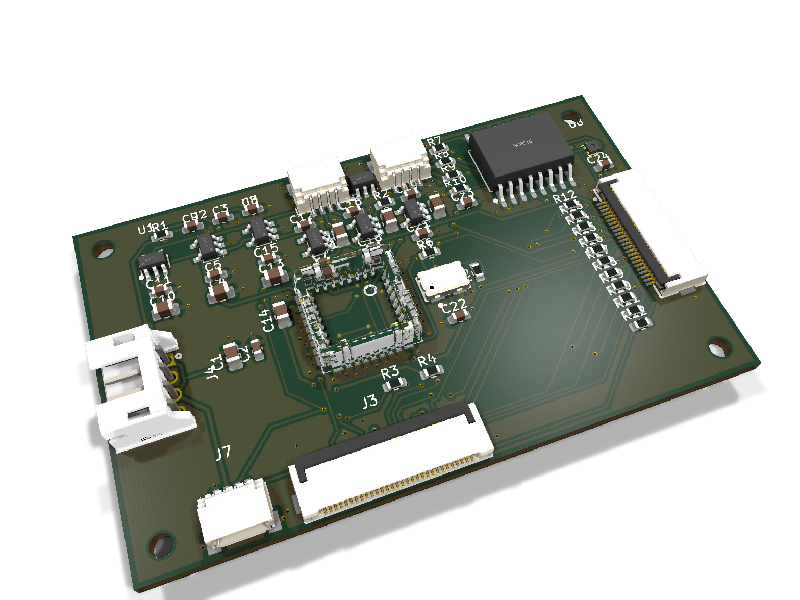
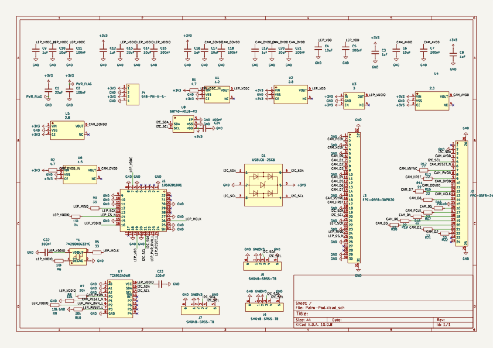

### MLX90640 board
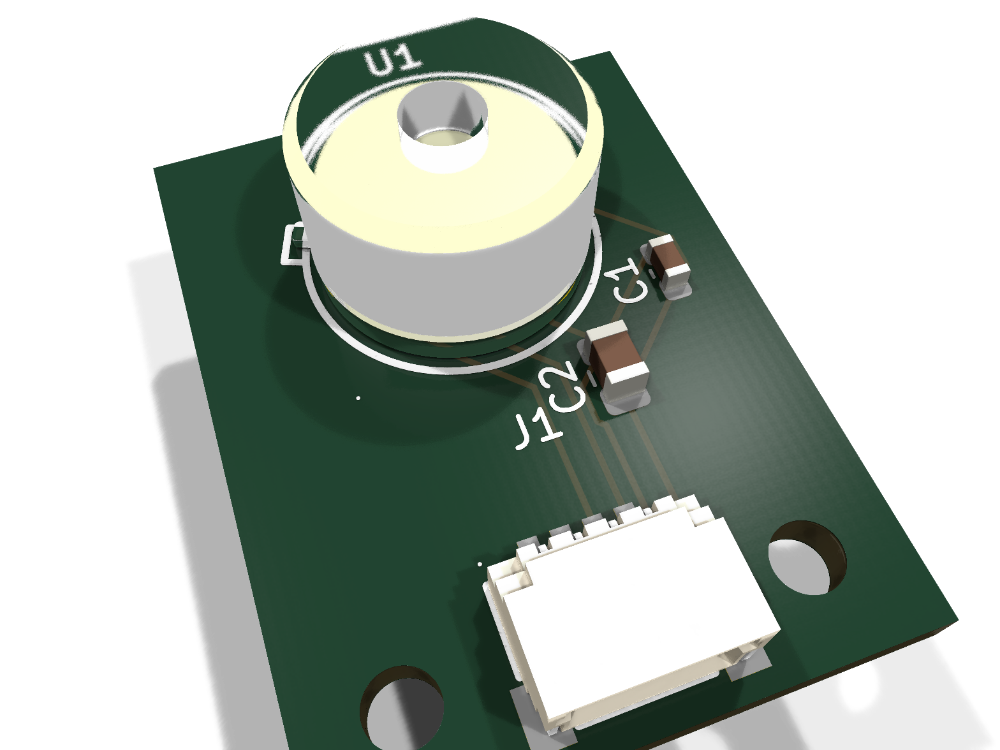
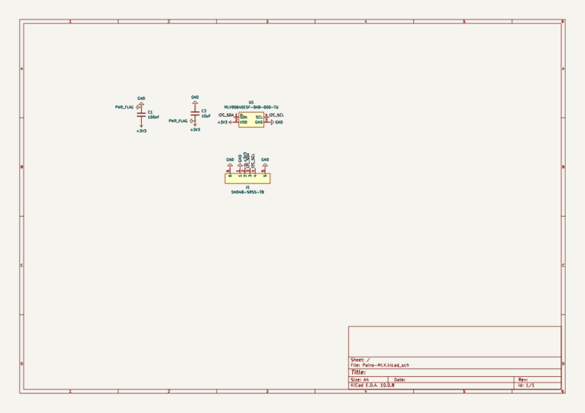

### TMP117 board
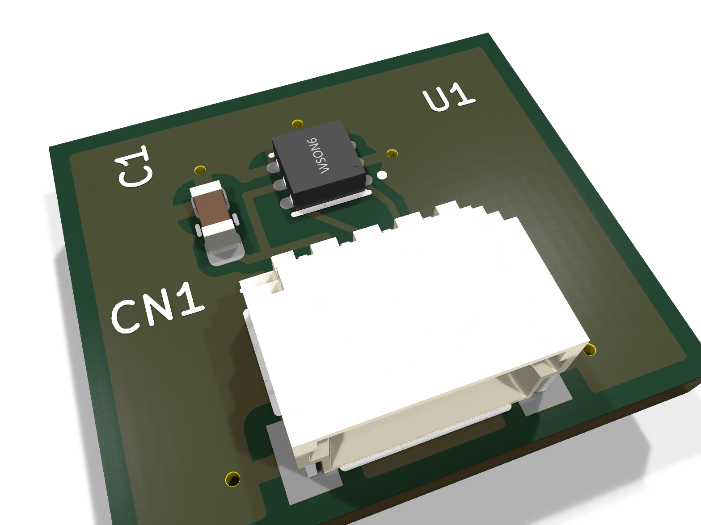
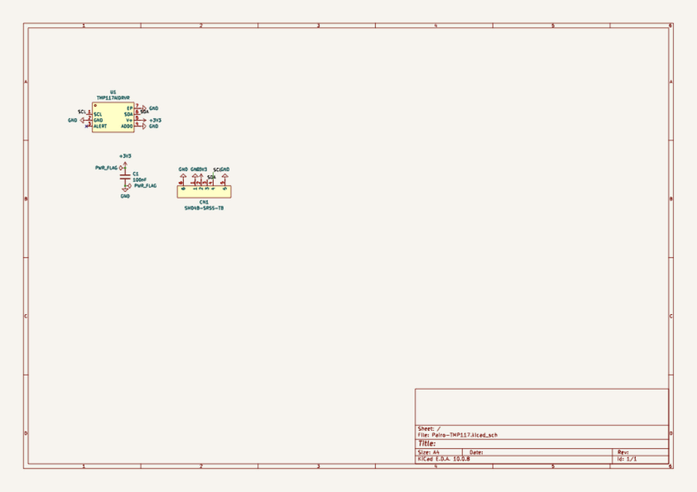

## Mechanical

The base is a birch plywood plate with a pocket for the aluminium cold plate. An aluminium frame holds the two 3D-printed heel cups, and a square aluminium tube holds the 3D-printed head above the feet. Under the cold plate is the Peltier with a heat sink and fan.

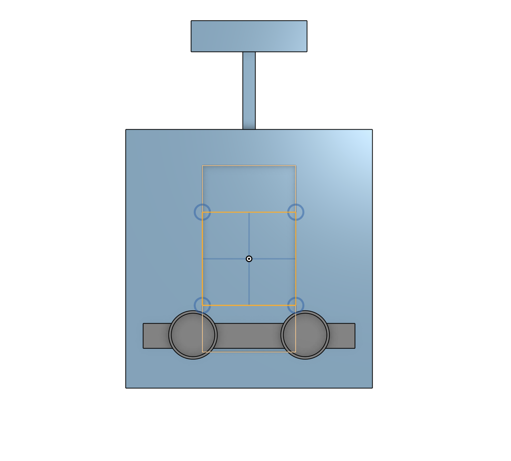
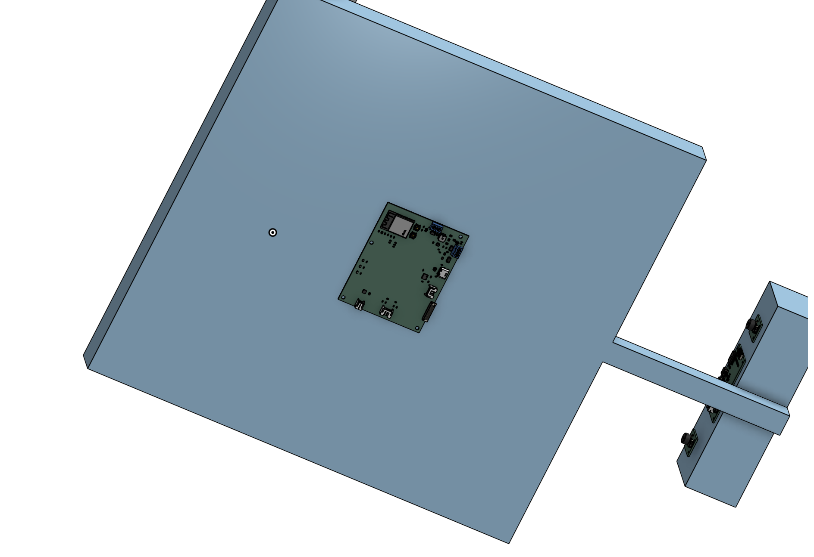

Onshape: https://cad.onshape.com/documents/0f48d2cc475e2a5b0b1a81b7/w/1ffe65a73207c401c42f968b/e/6f5d81889eeea614164d31f6

## Repo layout

```
pcb/main, pcb/head, pcb/mlx, pcb/tmp117   KiCad projects (.kicad_pro, .kicad_sch, .kicad_pcb, .kicad_prl)
pcb/libs                                  footprints, symbols and 3D models (from LCSC/EasyEDA, 3D models zipped)
gerbers.zip                               gerbers + drill files for all 4 boards
fab/                                      gerbers per board + part positions
cad/                                      STEP files: body, all 4 boards (big ones zipped), full assembly (zipped)
images/                                   renders and schematics
bom.csv                                   parts list in USD with links
firmware/                                 (in progress)
```

## Bill of materials

See [`bom.csv`](bom.csv). I'm ordering the PCBs and stencils from JLCPCB, the chips and small parts from LCSC, and the camera, Peltier, fan, speaker and cables from AliExpress. I solder everything myself with stencils and a hotplate.

- **Requested from Hack Club Fallen: ≈ $254** (incl. shipping and ~27 % VAT estimate)
- **Paid by me: ≈ $136** (wood, aluminium, filament, screws, solder paste, charger)
- **Total: ≈ $390**

I first planned a FLIR Lepton thermal camera, but its price went up to $121 and it is getting discontinued, so I switched to two MLX90640 sensors. I kept the Lepton socket footprint on the head board as an optional upgrade.
